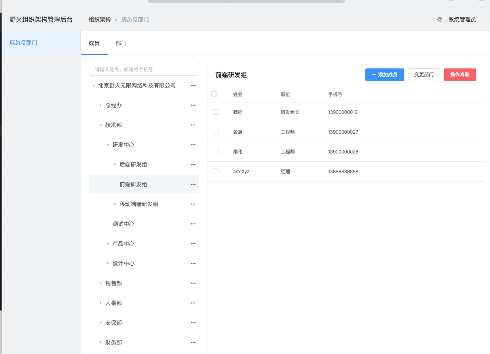
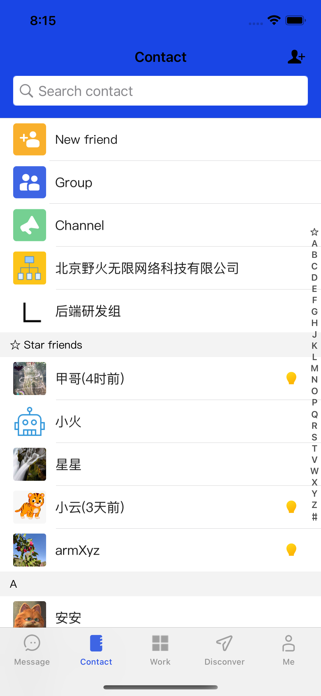
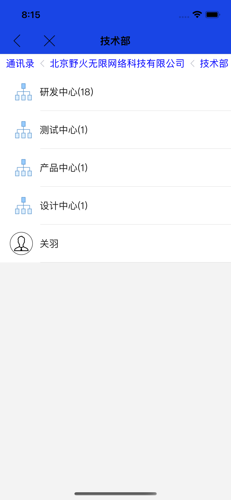
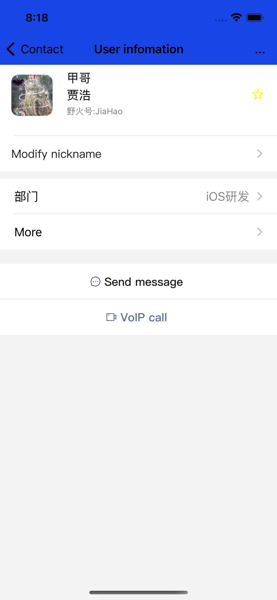
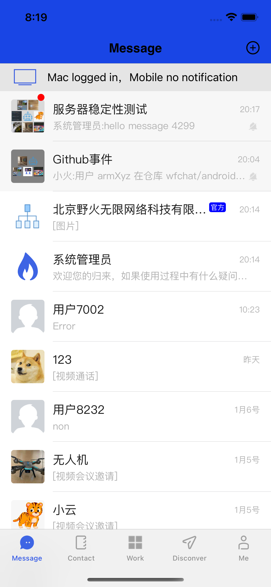

# 野火组织通讯录服务
组织通讯录服务提供企业或者单位组织架构和员工信息服务，员工可以浏览组织架构、选取员工来发送消息和发起音视频通话，不用添加好友既可以进行。野火组织通讯录服务包括后端服务和管理后台页面。可以登录管理后台进行组织管理。

## 后端服务
在后端服务中，提供两种类型的API，一种给管理页面用；另外一种给客户端查询使用。管理页面根据后台数据库中的用户/密码来登录。客户端在im client中取应用code，然后使用code来登录。管理页面可以修改组织通讯录数据，客户端只能查询。

## 数据结构
系统中有3种数据结构，分别是组织、员工和关系。关系数据比较特殊，在关系数据中记录员工与组织的层级关系。比如一个员工甲的组织路径为"公司/技术部/移动端/Android"，那么数据结构就存在下面4行

|  员工   | 部门  |  层级  | 上级部门 | 直属 |
|  ----  | ----  | ----  | ---- | ---- |
| 甲  | 公司 |  0  |  NULL | false |
| 甲  | 技术部 |  1  |  公司 | false |
| 甲  | 移动端 |  2  |  技术部 | false |
| 甲  | Android |  3  |  移动端 | true |

可以看出数据中存在大量的冗余数据，数据维护难度较大，但带来的好处就是查询比较方便和高效。

员工支持多部门，一个员工可以在多个部门中任职。

## 客户端使用
客户端登录成功以后，可以调用各个查询接口。一般在进入到通讯录界面，可以调取获取根组织的方法，获取公司。然后点开公司再一级一级地展开数据。

在用户的详情界面，可以查询用户的组织关系，这样就能展示用户的组织路径。点击具体路径就可以获取对应组织的信息详情。

客户端可以本地缓存数据，在需要显示时先使用缓存，再去服务器查询，如果有更新再刷新页面。

## 编译
组织通讯录服务包含后端服务和管理页面，需要分别进行编译。

### 管理页面的编译
1. 修改配置：
修改```organization-web/src/api/axios.config.js```把baseURL地址改成正确地址。

2. 进入项目的```organization-web```目录下，执行下属命令:
    ```
    npm install
    npm run build
    ```
编译成功后，生成的html文件会自动拷贝到后端服务的资源目录下，这样打包后端服务的时候就可以把页面打包进后端服务了。注意不能使用```yarn```，只能使用```npm```，否则会找不到页面。

### 后端服务的编译
需要先编译管理页面，管理页面编译成功后，进入项目的```organization-server```目录下，执行下属命令:
```
mvn clean package
```
生成的软件包在```organization-server/target/organization-platform-server-XXX.jar```。

## 部署
### 配置
部署之前需要把配置文件目录```organization-server/config```放到软件包的相同目录，然后编辑配置目录下的```application.properties```文件。有如下地方需要修改：
1. 应用的端口，默认是8880，可以修改为其他的端口。
2. 应用使用的数据库，默认是H2，可以直接运行，建议切换到mysql。
3. IM服务的Server API地址和密钥，必须修改为有效信息。
4. 否允许外部人员访问组织，如果是则非公司员工也可以看到组织通讯录，否则看不到。
5. 对象存储信息，配置之后可以在创建员工时设置头像等。默认 ```media.server.media_type=-1``` 表示未配置 OSS，此时上传头像会提示“未配置 OSS”。如需使用，请按如下说明修改：

    * ```media.server.media_type```：存储类型，-1 未配置（默认），1 七牛云，2 阿里云 OSS，3 野火私有对象存储（MinIO），4 野火对象存储网关（暂未实现），5 腾讯云 COS。
    * ```media.server_url```：OSS 服务端点地址。
    * ```media.access_key``` 和 ```media.secret_key```：OSS 访问密钥。
    * ```media.bucket_name```：存储桶名称。
    * ```media.bucket_domain```：存储桶访问域名，上传成功后会返回 ```{bucket_domain}/{随机文件名}``` 的访问地址。

    配置示例（七牛云）：
    ```properties
    media.server.media_type=1
    media.server_url=https://up.qbox.me
    media.access_key=你的AccessKey
    media.secret_key=你的SecretKey
    media.bucket_name=你的Bucket
    media.bucket_domain=http://你的Bucket域名
    ```

### 部署
把软件包```organization-platform-server-XXX.jar```放到云服务器上，确保配置目录在一起并正确配置后，执行命令：
```
nohup java -jar organization-platform-server-*.jar 2>&1 &
```

### Nginx 反向代理与 IP 白名单
默认打包部署时，organization-server API 和 organization-web 管理后台都跑在同一个端口（`8880`）上。如果希望对管理后台做 IP 白名单控制，推荐在前面加一层 Nginx 反向代理，通过 `allow/deny` 限制访问来源。

#### 1. 绑定后端到本地（可选但推荐）
在 `organization-server/config/application.properties` 中把服务绑定到 `127.0.0.1`，避免外网直接访问 8880 端口：

```properties
server.address=127.0.0.1
```

#### 2. Nginx 配置示例
以下配置仅允许 `10.0.0.0/24` 和 `192.168.1.100` 访问管理后台（`/`），客户端查询用的 `/api/` 接口保持公开可访问：

```nginx
server {
    listen 80;
    server_name org.example.com;

    # 管理后台：仅允许指定 IP
    location / {
        allow 10.0.0.0/24;
        allow 192.168.1.100;
        deny all;

        proxy_pass http://127.0.0.1:8880;
        proxy_set_header Host $host;
        proxy_set_header X-Real-IP $remote_addr;
        proxy_set_header X-Forwarded-For $proxy_add_x_forwarded_for;
    }

    # API 接口：给客户端和管理后台共用，根据业务需要决定是否加白名单
    location /api/ {
        proxy_pass http://127.0.0.1:8880/api/;
        proxy_set_header Host $host;
        proxy_set_header X-Real-IP $remote_addr;
        proxy_set_header X-Forwarded-For $proxy_add_x_forwarded_for;
    }
}
```

#### 3. 验证配置
修改 Nginx 配置后重载：

```bash
nginx -t
nginx -s reload
```

注意：如果 Nginx 和 organization-server 之间还有 SLB、CDN 等代理，`$remote_addr` 会是代理的地址，此时应改用 `$http_x_forwarded_for` 做限制，或在最外层代理上设置真实 IP 模块。

## 升级注意事项

从旧版本升级到当前版本时，除了替换 jar 和配置，还需要处理下面的配置/数据库兼容问题。否则会出现“服务启动不起来”或“登录报 sessionId 错误”。

### 1. 主数据源配置前缀已变化

当前版本的主数据源使用：

```java
@ConfigurationProperties(prefix = "spring.datasource.hikari")
```

所以配置必须是 `spring.datasource.hikari.*`，旧版本的 `spring.datasource.url/username/password/driver-class-name` 不会再被主数据源读取。

升级时请把旧配置：

```properties
spring.datasource.url=jdbc:mysql://...
spring.datasource.username=root
spring.datasource.password=...
spring.datasource.driver-class-name=com.mysql.cj.jdbc.Driver
```

改成：

```properties
spring.datasource.hikari.jdbc-url=jdbc:mysql://...
spring.datasource.hikari.username=root
spring.datasource.hikari.password=...
spring.datasource.hikari.driver-class-name=com.mysql.cj.jdbc.Driver
```

否则启动会报：

```text
IllegalArgumentException: dataSource or dataSourceClassName or jdbcUrl is required.
```

第二个、第三个数据源同理，分别使用：

```properties
spring.secondary-datasource.hikari.*
spring.im-datasource.hikari.*
```

不需要第二个/第三个数据源时，可以整段注释掉，服务仍可启动；只是“今日使用情况”等依赖 IM 库的接口不可用。

### 2. 检查 shiro_session 的历史列 sessionId

旧库的 `shiro_session` 表里可能同时存在两列：

```sql
session_id   varchar(128) NOT NULL  -- 主键，当前代码实际使用
session_data blob
sessionId    varchar(128) NOT NULL  -- 历史遗留列
```

当前实体 `ShiroSession` 的 Java 字段虽然叫 `sessionId`，但 Hibernate 会按命名策略映射到数据库列 **`session_id`**，不会使用 `sessionId` 这个物理列。如果历史遗留的 `sessionId` 是 `NOT NULL` 且没有默认值，登录时会报：

```text
Field 'sessionId' doesn't have a default value
could not execute statement
```

升级前先检查：

```sql
SHOW CREATE TABLE shiro_session;

SELECT COUNT(*)
FROM shiro_session
WHERE sessionId IS NOT NULL;
```

如果 `sessionId` 全部为 NULL，且没有索引、外键、触发器、视图引用它，可以按下面方式处理。

先备份数据：

```bash
mysqldump -h <db_host> -u <user> -p \
  --no-create-info --skip-triggers \
  organization_server shiro_session > shiro_session_backup.sql
```

方案 A（最稳，先让插入不再失败）：

```sql
ALTER TABLE shiro_session
MODIFY COLUMN sessionId varchar(128)
CHARACTER SET utf8mb4 COLLATE utf8mb4_unicode_ci
NULL DEFAULT NULL;
```

方案 B（确认无用后彻底删除）：

```sql
ALTER TABLE shiro_session DROP COLUMN sessionId;
```

> 建议先执行方案 A，确认登录正常后再执行方案 B。`spring.jpa.hibernate.ddl-auto=update` 只会新增列，不会删除历史列，所以这个遗留列不会自动消失。

同类问题不只 `sessionId`。历史库里还可能同时存在 snake_case 和 camelCase 两套列，例如：

| 表 | snake_case（有数据） | camelCase（历史遗留） |
|---|---|---|
| `t_organization` | `create_dt` / `update_dt` / `portrait_url` | `createDt` / `updateDt` / `portraitUrl` |
| `t_relationship` | `create_dt` / `update_dt` | `createDt` / `updateDt` |
| `t_employee` | `portrait_url` | `portraitUrl` |
| `t_user` | `password_md5` | `passwordMd5` |
| `t_optlog` | `operation_desc` | `operationDesc` |

当前实体已显式映射到 snake_case 列。升级时请确认数据在 snake_case 列中；否则会出现：

```text
Null value was assigned to a property ... of primitive type
```

或者管理员密码校验失败。不要只把数据写到 camelCase 列，`ddl-auto=update` 也不会自动合并这两套列。

### 3. im.admin_url 和 im.admin_secret

`im.admin_url` 必须是**签发 authCode 的那套 IM** 的管理接口地址，`im.admin_secret` 必须是该 IM 的 `http.admin.secret_key`。

```properties
im.admin_url=http://<im-admin-host>:18080
im.admin_secret=<http.admin.secret_key>
```

如果 authCode 不是这套 IM 签发的，或者密钥不一致，IM 会返回：

```json
{"code":6,"msg":"token error"}
```

服务端日志里可以看到请求已经到达：

```text
AdminHttpUtils : http request content: {"authCode":"..."}
AdminHttpUtils : http request response content: {"code":6,"msg":"token error"}
```

同时确认运行 organization-server 的机器能访问该 `im.admin_url` 的 `18080` 端口。

### 4. 外部人员访问与手机号同步

#### 外部人员访问组织架构

```properties
# true：不在组织架构内的外部人员也可以登录并查看组织架构（只授予 user:view）
# false：只有 t_employee 中存在的员工才能登录
organization.allow_external_staff_access=true
```

这个开关只控制外部人员能否登录和查看，不会授予管理员权限。

如果外部人员查看组织架构返回 `{"code":14,"message":"没有权限"}`，先确认：

1. 配置确实是 `organization.allow_external_staff_access=true`；
2. 客户端已经成功调用 `/api/user_login` 并保存了响应头里的 `authToken`；
3. 后续请求是否带上了 `authToken`；
4. 服务端日志是否有 `Permission denied: uri=..., principal=..., authenticated=false`。

`authenticated=false` 表示请求没有有效登录态，不是 `allow_external_staff_access` 没生效。

#### 是否同步员工手机号到 IM

```properties
# true：创建/更新员工时，把组织库中的手机号同步到 IM 用户资料
# false：手机号只保存在组织库，不写入 IM
organization.sync_user_mobile=true
```

默认 `true`，保持旧版本行为。设置为 `false` 后：

- 创建员工时不会把手机号写入 IM；
- 更新员工时不会修改 IM 中已有的手机号；
- 组织库里的 `t_employee.mobile` 仍然正常保存；
- 通过手机号查找已有 IM 用户的逻辑也会跳过。

### 5. Web 端跨域必须配置 allowed_origins

如果 Web 客户端和 organization-server 不同源（例如 Web 端是 `https://web.wildfirechat.cn`，API 是 `https://org.wildfirechat.net`），必须在 `application.properties` 中配置：

```properties
wfc.cors.allowed_origins=https://web.wildfirechat.cn
```

多个来源用英文逗号分隔。默认留空表示不允许任何跨域。

没有配置时，浏览器会先发 `OPTIONS /api/user_login` 预检请求，服务端返回：

```text
HTTP/1.1 403
Invalid CORS request
```

浏览器随后不会发送真正的 `POST /api/user_login`，所以服务端日志里也不会出现 `Request: user_login`。这不是客户端没有发请求，而是预检被 CORS 拦截了。

服务端会在 `CorsFilter` 中打印拒绝日志，方便定位：

```text
WARN  cn.wildfirechat.org.shiro.CorsFilter : CORS rejected: origin=https://web.example.com, method=OPTIONS, uri=/api/user_login, allowedOrigins=[https://web.wildfirechat.cn]
```

启动时也会打印当前允许的来源：

```text
INFO  cn.wildfirechat.org.shiro.CorsFilter : CORS allowed origins: [https://web.wildfirechat.cn]
```

iOS/Android 原生客户端不走 CORS，不受这个配置影响。

### 6. 升级后建议客户端重新登录

当前版本升级了 Shiro，并收紧了会话反序列化白名单。升级后旧 `authToken` 可能无法继续使用，建议通知客户端重新登录一次，避免继续携带旧 session 导致反复跳登录页。

### 7. 启动脚本参数位置

`-Xmx` 是 JVM 参数，必须放在 `-jar` 前面：

```bash
nohup java -Xmx256M -jar organization-platform-server-*.jar > nohup.out 2>&1 &
```

写成 `java -jar xxx.jar -Xmx256M` 时，`-Xmx256M` 会被当成程序参数，JVM 堆大小不会生效。

### 升级检查清单

- [ ] 主数据源已改为 `spring.datasource.hikari.*`
- [ ] 第二/第三数据源按需配置，前缀分别为 `spring.secondary-datasource.hikari.*`、`spring.im-datasource.hikari.*`
- [ ] 已检查 `shiro_session` 是否存在多余的 `sessionId` 列
- [ ] 已备份 `shiro_session` 数据
- [ ] 已处理 `sessionId` 列（改可空或删除）
- [ ] 已确认 `organization.allow_external_staff_access` 是否符合预期
- [ ] 已确认 `organization.sync_user_mobile` 是否符合隐私要求
- [ ] Web 端跨域已配置 `wfc.cors.allowed_origins`
- [ ] 启动脚本中 `-Xmx` 在 `-jar` 之前
- [ ] 升级后客户端重新登录验证

## 登录
浏览器打开```http://{IP}:8880```进入到管理后台界面，默认账户/密码为 ```admin/admin123```  登陆以后注意修改默认密码。

## 导入数据
在管理后台未创建任何组织的情况下，需要在后台下载导入模版，填入模版后然后上传导入所有组织架构和成员信息。在成员那个页面，选择批量导入，按照提示下载模版和上传文件。

模版中带有示例人员信息，可以导入作为测试数据进行测试。

当数据库中已经有数据的情况下，导入按钮会隐藏，可以手动调整各项数据。

当数据库为空时，无法手动创建用户和组织，必须先导入数据后再手动调整（可以二开来改掉这个限制）。

## 截图

管理后台页面


联系人页面


组织树


员工名片


官方群


## 常见问题
1. 输入地址后，打不开管理页面？
A. 前端页面打包后，会把页面放入到```organization-server\src\main\resources\static```目录中，请检查是否存在。如果不存在，请检查是否执行过编译前端页面。如果用yarn编译，也会出问题，请用npm编译。

2. 登录后无法创建部门？
A. 设计是需要先导入数据，导入数据后再手动更新。请确认先导入后，再手动调整。如果需要手动创建部门，可以二开修改源码。

3. 配置文件中的关于IM的是什么信息？
A. 此服务需要更新IM服务用户信息，因此需要配置IM服务的管理地址和密钥。请修改```im.admin_url```和```im.admin_secret```，改为正确的地址。

4. 部署之后，如何提供给客户端使用？
A. 这个服务还提供API给客户端使用，最简单的方法就是把```http://IP:8880```替换客户端配置文件里的地址。当然建议使用域名和HTTPS，这样能够保证安全还有灵活性。

## Lisence
UNDER MIT LICENSE. 详情见LICENSE文件
